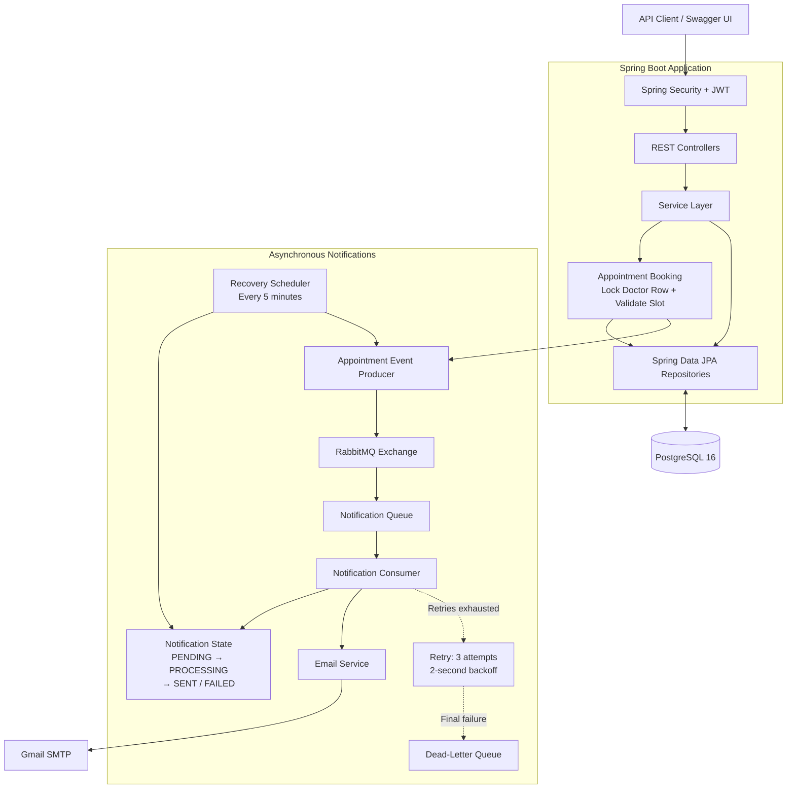

# MediFlow — Clinic Appointment Management Backend

A clinic appointment backend with PostgreSQL-backed booking, concurrent double-booking protection, JWT authentication, and asynchronous email notifications using Spring Boot and RabbitMQ.

## Demo

**Swagger UI:** [http://localhost:8080/swagger-ui/index.html](http://localhost:8080/swagger-ui/index.html)

Add a short 60–90 second demo recording showing login, booking an appointment, and receiving the notification email.

## Key Features

- **Authentication:** JWT authentication, Spring Security, BCrypt password hashing, and role-based access control.
- **Patient management:** Patient registration and retrieval.
- **Doctor management:** Doctor profiles and specializations.
- **Availability:** Doctor availability management and slot validation.
- **Appointments:** Booking, lifecycle management, and protection against concurrent bookings for the same slot.
- **Notifications:** RabbitMQ-based asynchronous appointment notifications, retry handling, dead-letter routing, and scheduled recovery.
- **Persistence:** PostgreSQL with Spring Data JPA and Hibernate.

The application defines four roles: **ADMIN, DOCTOR, PATIENT, and RECEPTIONIST**. Access to protected operations is determined by the configured authorization rules.

## Architecture



### Appointment booking

1. The API authenticates and authorizes the request.
2. The booking service locks the doctor's database row for the duration of the transaction.
3. The service revalidates the requested slot: it must be in the future, respect the 30-minute booking boundary, fall within the doctor's availability, and not overlap another appointment.
4. The appointment is persisted in PostgreSQL.
5. An appointment event is published for asynchronous notification processing.

The doctor-row lock serializes competing booking attempts that use the same locking strategy, while the availability checks prevent conflicting bookings.

### Notification processing and recovery

1. The appointment event is published to RabbitMQ.
2. A notification consumer processes the event and sends the email.
3. Email sending retries three times with a two-second backoff.
4. If delivery still fails, the notification is marked `FAILED` and the message is routed to the dead-letter queue.
5. A scheduler runs every five minutes and republishes notifications that remain `PENDING`. The claim-state transition — `PENDING` → `PROCESSING` → `SENT` / `FAILED` — helps prevent duplicate processing.

## Design Decisions

### 1. Protecting concurrent bookings

Booking locks the doctor's row for the duration of the transaction, then revalidates the slot before saving. The validation checks the future time, 30-minute boundary, doctor availability, and overlapping appointments.

`AppointmentConcurrencyIntegrationTest.onlyOnePatientCanBookTheSameSlotConcurrently` runs two competing booking threads against a real PostgreSQL 16 Testcontainers instance and asserts that exactly one booking succeeds.

This test requires Docker to be available.

### 2. Why RabbitMQ?

Email delivery is external to the booking operation and can fail temporarily. RabbitMQ lets the application process notifications asynchronously and separates notification processing from the request-handling path.

A small clinic could implement notifications without a broker. RabbitMQ is used here to explore message delivery, acknowledgements, retries, dead-letter handling, and asynchronous processing.

### 3. Handling notification failures

Email sending retries three times with a two-second backoff. If it still fails, the notification is marked `FAILED` and the message is routed to the dead-letter queue.

The recovery scheduler republishes notifications that remain `PENDING`. Notification claim-state transitions help avoid duplicate processing.

### 4. Transaction and event consistency

Appointment events are currently published inside the booking transaction, before the transaction commits. This leaves a consistency risk: the message could be published even if the database transaction subsequently rolls back.

A future improvement is the **transactional outbox pattern**, which records the event in the same database transaction and publishes it after commit.

The recovery job also republishes a fixed “created” event type. A future improvement would be to preserve and replay the original event type and payload for each notification.

## Technology Stack

| Component | Technology |
|---|---|
| Language | Java 21 |
| Backend | Spring Boot |
| Security | Spring Security, JWT, BCrypt |
| Persistence | Spring Data JPA, Hibernate |
| Database | PostgreSQL 16 |
| Messaging | RabbitMQ, Spring AMQP |
| Email | Gmail SMTP |
| API documentation | Springdoc / Swagger UI |
| Containerization | Docker, Docker Compose |
| Testing | JUnit, Spring Boot Test, Testcontainers |

## Getting Started

### Prerequisites

- Git
- Docker Desktop with Docker Compose, or Docker Engine with the Compose plugin
- A Gmail App Password if you want to test email delivery

### 1. Clone the repository

```bash
git clone https://github.com/aayushships/MediFlow.git
cd MediFlow
```

### 2. Configure environment variables

Create a local `.env` file from the template.

**Windows PowerShell**

```powershell
Copy-Item .env.example .env
```

**Linux / macOS**

```bash
cp .env.example .env
```

Edit `.env` and set your own credentials:

```dotenv
DB_PASSWORD=your_database_password
RABBITMQ_USER=mediflow
RABBITMQ_PASSWORD=your_rabbitmq_password
MAIL_USERNAME=your_email@gmail.com
MAIL_PASSWORD=your_gmail_app_password
JWT_SECRET=your_long_random_secret
```

Use the exact variable names from `.env.example`. For Gmail, use an App Password rather than your normal account password.

**Never commit your real `.env` file or publish its secrets.**

### 3. Start the services

```bash
docker compose config --quiet
docker compose up -d --build
```

Check the container status:

```bash
docker compose ps
```

View the application logs:

```bash
docker compose logs --tail=100 app
```

Look for `Started MediFlowApplication` and a successful RabbitMQ connection.

### 4. Access the services

| Service | Address | Purpose |
|---|---|---|
| MediFlow API | `http://localhost:8080` | REST API |
| Swagger UI | `http://localhost:8080/swagger-ui/index.html` | API documentation and testing |
| PostgreSQL | `localhost:5433` | Host access to the database |
| RabbitMQ management UI | `http://localhost:15673` | Exchanges, queues, and messages |

The Compose configuration uses internal service names for communication: the app connects to PostgreSQL at `postgres:5432` and RabbitMQ at `rabbitmq:5672`.

The RabbitMQ management UI is mapped from host port `15673` to container port `15672` to avoid a conflict with an existing local RabbitMQ installation. If you change the port mapping, update the URL accordingly.

### 5. Authentication

Use the authentication endpoints listed in Swagger to register or log in, then provide the JWT as a Bearer token when required.

The application does not document a universal default administrator account. Use the supported account-provisioning process in the repository to create an administrator.

### 6. Stop the services

```bash
docker compose down
```

This stops and removes the Compose containers but preserves named volumes.

Avoid `docker compose down -v` unless you intentionally want to delete the persistent PostgreSQL and RabbitMQ data.

## API Overview

Swagger UI contains the request schemas, response formats, and full endpoint list.

| API area | Purpose |
|---|---|
| Authentication API | Registration, login, and JWT issuance |
| Patient API | Patient records and related operations |
| Doctor API | Doctor profile management |
| Availability API | Doctor availability and slot queries |
| Appointment API | Booking and appointment lifecycle operations |

Authorization depends on the configured roles and security rules. Consult Swagger and the security configuration for exact endpoint paths and permitted roles.

## Testing

Run the Maven verification suite from the project root.

**Windows PowerShell**

```powershell
.\mvnw.cmd clean verify
```

**Linux / macOS**

```bash
./mvnw clean verify
```

**Docker must be running** because `AppointmentConcurrencyIntegrationTest.onlyOnePatientCanBookTheSameSlotConcurrently` starts a PostgreSQL 16 container through Testcontainers.

The test suite covers application behavior through the project's configured unit and integration tests. Run the command locally and verify the test results before claiming that the suite passes.

## Known Limitations and Next Steps

- **No dedicated frontend:** The project focuses on the backend and exposes its API through Swagger UI.
- **Event publication before commit:** Publishing appointment events inside the booking transaction creates a consistency risk. A transactional outbox is a potential improvement.
- **Fixed recovery event type:** The recovery job republishes a fixed “created” event type rather than preserving the original event type and payload.
- **Observability:** Structured logging, metrics, and tracing could make failures easier to diagnose.
- **Service decomposition:** Large service classes can be refactored into smaller components with clearer responsibilities.
- **Deployment hardening:** Production deployments need appropriate TLS, network restrictions, secret management, backups, and operational monitoring.

## Project Goals

MediFlow is a practical backend engineering project focused on REST APIs, relational data modeling, concurrent booking protection, authentication and authorization, and reliable asynchronous messaging.

The goal is to demonstrate these concepts through a clinic appointment workflow rather than a generic CRUD-only application.
